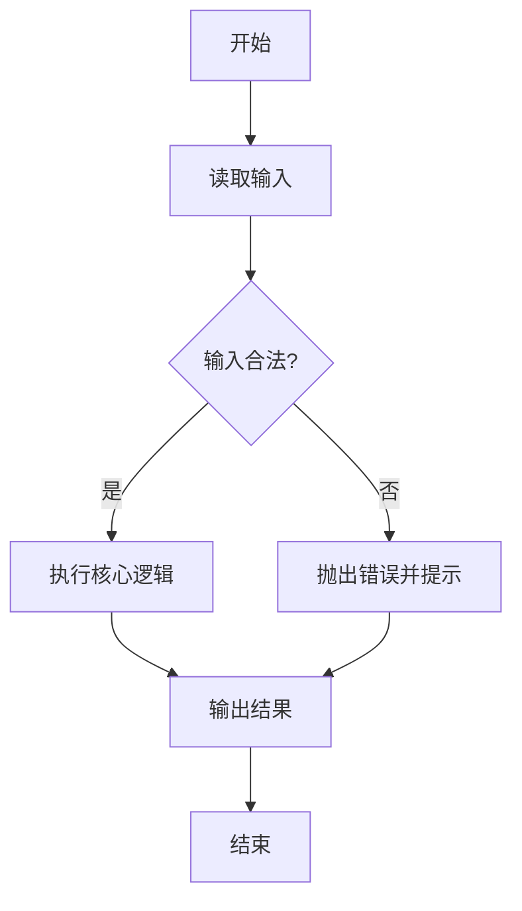

> [!NOTE]
> 这是一篇「既讲知识、又当排版样板」的文章：下面大量使用 Shirone 的扩展 Markdown 组件，方便你直接在页面上看到渲染效果。

## 为什么选择 Python

Python 语法接近自然语言，==可读性极高==，适合初学者入门，也广泛用于数据分析、人工智能、自动化脚本与 Web 后端。它由 Guido van Rossum 于 1991 年发布，奉行「优雅、明确、简单」的设计哲学。

::: tip[学习建议]
先跑通「能运行」，再谈「写得好」。每天写一点、跑一点，比只看不练有效得多。
:::

## 第一个程序

::: steps{title="三步跑通第一个 Python 程序"}

1. **安装 Python**

   到 python.org 下载 3.x 版本并安装，终端验证：

   ```bash
   python --version
   ```

2. **写一个文件**

   新建 `hello.py`，内容见下方代码块。

3. **运行它**

   ```bash
   python hello.py
   ```

:::

```python {1} title="hello.py"
# 第一个 Python 程序
name = "世界"
print("你好，" + name + "！")
```

## 变量与基本类型

变量不需要声明类型，直接赋值即可；常用类型如下。

| 类型 | 示例 | 说明 |
| :--- | :--- | --- |
| int | `42` | 整数 |
| float | `3.14` | 浮点数 |
| str | `"你好"` | 字符串 |
| bool | `True` / `False` | 布尔值 |
| NoneType | `None` | 空值 |

```python {2,5} title="types.py"
age = 18                # int
price = 9.9             # float
name = "小明"            # str
is_student = True       # bool
nothing = None          # None
print(type(age), type(price), type(name))
```

上面第 ==2 行== 和第 ==5 行== 分别定义了一个浮点数与空值。Python 使用动态类型，变量类型在运行时确定。

*[GIL]: 全局解释器锁（Global Interpreter Lock），CPython 中同一时刻只允许一个线程执行字节码。
*[REPL]: 交互式解释器环境（Read-Eval-Print Loop）。

由于 ==GIL== 的存在，多线程在 CPU 密集任务上并不能真正并行；可以用多进程或异步来绕开。

## 条件与循环

::: tabs#control-flow

@tab 条件判断#if

```python title="if_demo.py"
score = 85
if score >= 90:
    grade = "A"
elif score >= 60:
    grade = "及格"
else:
    grade = "不及格"
print(grade)
```

@tab for 循环#for

```python title="for_demo.py"
for i in range(1, 4):
    print("第", i, "次")
```

@tab while 循环#while

```python title="while_demo.py"
count = 3
while count > 0:
    print(count)
    count -= 1
print("发射！")
```

:::

> [!TIP]
> `range(1, 4)` 生成 1、2、3，==左闭右开== 是 Python 里非常常见的设计。

## 函数

用 `def` 定义函数，支持默认参数、关键字参数与可变参数。

```python {2,4-5} title="func.py"
def greet(name, greeting="你好"):
    """向指定的人问好。"""
    return f"{greeting}，{name}！"

print(greet("小明"))                  # 你好，小明！
print(greet("Tom", greeting="Hello")) # Hello，Tom！
```

Python 的列表推导式 [+listcomp] 非常简洁，值得优先掌握。

[+listcomp]:
  列表推导式指形如 `[x*x for x in range(5)]` 的语法，用一行表达式生成列表，等价于一个 for 循环加 append。

::: caution 命名冲突
不要用 `list`、`dict`、`str` 这类内置名当变量名，否则会覆盖内置类型。
:::

## 常用数据结构

| 结构 | 写法 | 特点 |
| :--- | :--- | :--- |
| list 列表 | `[1, 2, 3]` | 有序、可变 |
| tuple 元组 | `(1, 2, 3)` | 有序、不可变 |
| dict 字典 | `{"a": 1}` | 键值对 |
| set 集合 | `{1, 2, 3}` | 无序、去重 |

::: collapse accordion

- :+ 列表常用操作

  `append(x)` 追加、`pop()` 弹出、`sort()` 排序、`len(lst)` 求长度、切片 `lst[1:3]` 取子列表。

- 字典常用操作

  `d[key]` 取值、`d.get(key, default)` 安全取值、`d.items()` 遍历键值对、`d.keys()` / `d.values()`。

- 集合常用操作

  `add(x)` 添加、`remove(x)` 删除、`|` 并集、`&` 交集、`-` 差集。

:::

```python title="data_structures.py"
nums = [3, 1, 2]
nums.append(4)
nums.sort()
print(nums)              # [1, 2, 3, 4]

info = {"name": "小明", "age": 18}
print(info.get("age"))   # 18
print(set(nums) & {2, 5})  # {2}
```

## 面向对象

::: code-tree{title="一个最小的 Python 项目" entry="main.py" height="360px"}

```python title="main.py"
from models import User

u = User("小明", 18)
u.say_hello()
```

```python title="models.py"
class User:
    def __init__(self, name: str, age: int):
        self.name = name
        self.age = age

    def say_hello(self) -> None:
        print(f"我是 {self.name}，今年 {self.age} 岁。")
```

:::

::: file-tree{title="项目结构示例"}
- main.py
- models.py
- requirements.txt
- app/
  - __init__.py
  - utils.py
:::

## 异常处理

用 `try / except / finally` 捕获并处理错误，而不是让程序直接崩溃。

```diff title="before_after.py"
- result = 10 / 0          # 直接崩溃：ZeroDivisionError
+ try:
+     result = 10 / 0
+ except ZeroDivisionError:
+     result = "不能除以 0"
+ finally:
+     print("执行结束")
```

> [!WARNING]
> 不要用裸 `except:` 吞掉所有异常，至少写明要捕获的异常类型，否则会掩盖真正的 bug。

## 数学与公式

Python 内置 `math` 模块，也常用于科学计算（NumPy / SciPy）。

行内公式：圆的面积 $S = \pi r^2$。

块级公式：

$$
\int_{-\infty}^{\infty} e^{-x^2}\,dx = \sqrt{\pi}
$$

```python collapse={3-6} title="math_demo.py"
import math

r = 2
area = math.pi * r ** 2
print(round(area, 2))   # 12.57
print(math.sqrt(16))    # 4.0
```

## 程序执行流程（Mermaid）



## 参数说明（字段组）

:::: field-group

::: field name
@type str
@required

用户名，用于登录与展示。
:::

::: field age
@type int
@optional

年龄，默认值为 `0`。
:::

::::

::github{repo="python/cpython"}

## 小结

- 变量与类型：==动态类型==，常用 int / float / str / bool / None。
- 控制流：`if / elif / else`、`for`、`while`。
- 函数：`def`、默认参数、关键字参数。
- 数据结构：list / tuple / dict / set。
- 面向对象：`class` 与 `self`。
- 异常处理：`try / except / finally`。
- 终极答案藏在下面：:spoiler[多写、多跑、多改]。

::: details 点击查看「下一步学什么」
掌握基础语法后，推荐依次学习：文件与异常 → 模块与包 → 面向对象进阶 → 常用标准库 → 虚拟环境与 pip → 一个小项目（爬虫 / 数据处理 / Web）。
:::
